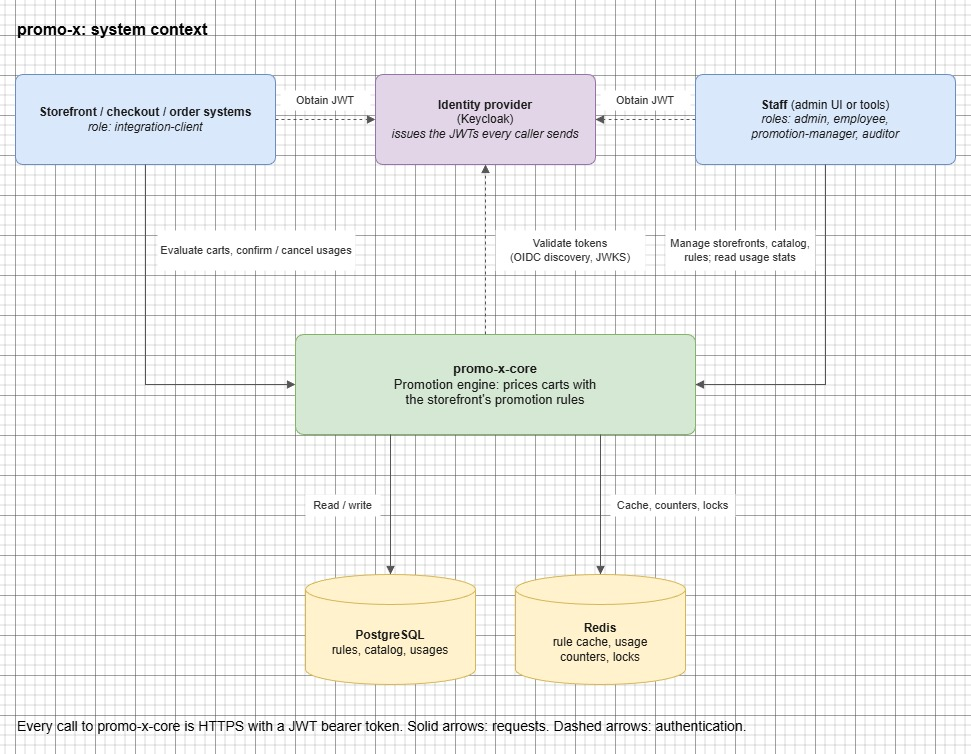
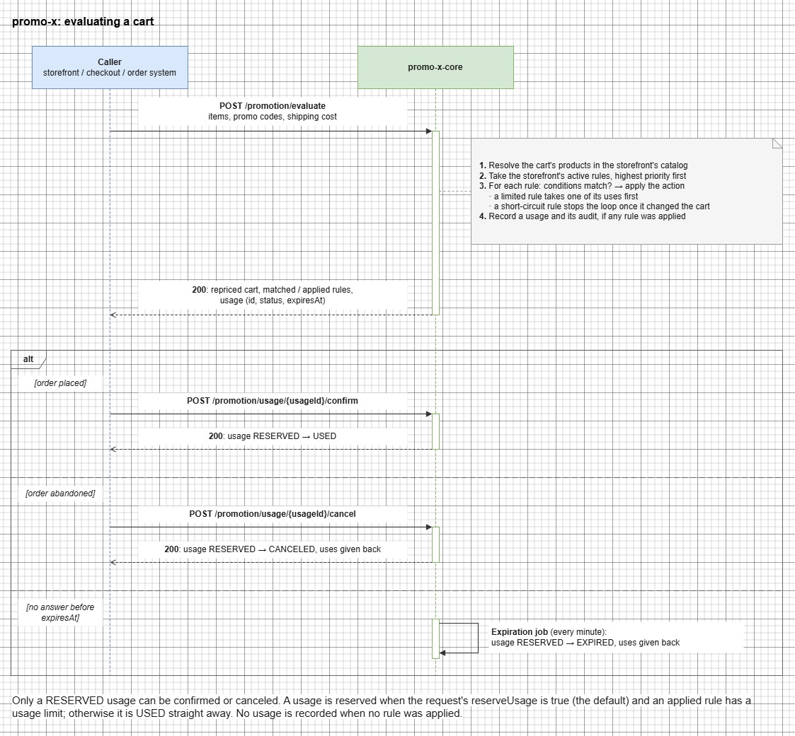

# promo-x architecture

This document describes promo-x as a system: who uses it, what it does and the rules it follows. How the
backend implements it is in [promo-x-core/architecture.md](promo-x-core/architecture.md).

## Context

promo-x is a promotion engine. It doesn't sell anything or take payments itself. Other systems call it while a
customer shops, and it tells them what the cart costs once the applicable promotions are applied.

- **Calling systems** send carts to evaluate and later confirm or cancel the resulting usage.
- **Staff** set up storefronts, keep the catalog in sync, write promotion rules and read the statistics.
- **The identity provider** authenticates both. promo-x only checks the tokens and their roles.

Infrastructure that future promo-x services will share, such as the Keycloak setup, lives in `common-infra/`.

## Storefronts

Everything in promo-x belongs to a **storefront**: a shop, a brand or a sales channel. Each storefront has its own
catalog, rules and usages, and a request names its storefront in the `X-Storefront-Id` header. Rules of one
storefront never apply to another.

## Catalog

Rules talk about products and categories by their **external IDs**, the IDs the calling system already uses, so
callers never need to know promo-x's own IDs. promo-x keeps a copy of each storefront's categories and products
for two reasons:

- **Validating rules:** a rule may only refer to products and categories that exist in its storefront.
- **Evaluating carts:** the caller sends product external IDs, and promo-x resolves each product's categories itself.

When a category's external ID changes, the active rules that refer to the old ID are deactivated rather than left
pointing at a category that no longer exists. They can be fixed and activated again with existing IDs.

## Promotion rules

A rule says "when the cart looks like this, change its price like that". It has:

| Part | Meaning |
|---|---|
| Condition tree | Conditions about the cart, combined with logical operators (`COMPOSITE`) |
| Action | The financial change made when the conditions match |
| Priority | Rules are evaluated from the highest priority down |
| Short-circuit | Once this rule actually changes the cart, lower-priority rules are skipped |
| Usage limit | Optional: how many times the rule may be applied in total |
| Active flag | Only active rules are evaluated |

### Conditions

| Condition | Matches when |
|---|---|
| `PROMO_CODE` | A given promo code was entered |
| `SUBTOTAL` | The cart's subtotal compares to a threshold |
| `CUSTOMER_AUTHENTICATION_STATE` | The customer is (or isn't) registered |
| `SINGLE_PRODUCT_EXTERNAL_ID_MATCH`, `PRODUCT_EXTERNAL_ID_ANY_MATCH` | A product, or any of several, is in the cart |
| `SINGLE_PRODUCT_SKU_MATCH`, `PRODUCT_SKU_ANY_MATCH` | The same, by SKU |
| `SINGLE_PRODUCT_CATEGORY_MATCH`, `PRODUCT_CATEGORY_ANY_MATCH` | A product from a category, or any of several, is in the cart |
| `SINGLE_PRODUCT_COLLECTION_MATCH`, `PRODUCT_COLLECTION_ANY_MATCH` | The same, by collection |
| `PRODUCT_EXTERNAL_ID_QUANTITY`, `PRODUCT_SKU_QUANTITY` | A product is in the cart in a given quantity |
| `COMPOSITE` | Its child conditions combine to true |

### Actions

| Action | Effect |
|---|---|
| `PRODUCT_EXTERNAL_ID_PERCENTAGE_DISCOUNT_ACTION`, `PRODUCT_PERCENTAGE_DISCOUNT_ACTION` | Percentage off a product, by external ID or by SKU |
| `PRODUCT_EXTERNAL_ID_BUY_X_GET_X_FREE_ACTION`, `PRODUCT_SKU_BUY_X_GET_X_FREE_ACTION` | Buy X, get Y of the same product free |
| `ORDER_PERCENTAGE_DISCOUNT` | Percentage off the order, spread across its lines |
| `ORDER_FLAT_DISCOUNT` | A fixed amount off the order, spread across its lines |
| `FREE_SHIPPING_ACTION` | Shipping costs nothing |
| `SHIPPING_PERCENTAGE_DISCOUNT` | Percentage off shipping |

An action that changes nothing, such as free shipping on an order whose shipping is already free, counts as not
applied: it doesn't stop lower-priority rules and doesn't use up the rule's limit.

## Evaluating a cart

The response has the totals before and after, the item and shipping discounts, each line's price before and after,
the rules that matched and the rules that were applied.

## Usages

A **usage** records one evaluation that applied at least one rule. It exists so usage limits can be enforced and so
there is a history to report on.

| Status | Meaning |
|---|---|
| `RESERVED` | A usage-limited rule was applied, and its use is held until the caller confirms or cancels |
| `USED` | Confirmed, or counted as used right away |
| `CANCELED` | The caller canceled; the held uses are back |
| `EXPIRED` | Not confirmed within the reservation TTL (15 minutes by default); the held uses are back |

A usage is reserved only when the caller asks for it (`reserveUsage`, true by default) and at least one applied rule
has a usage limit. Otherwise there is nothing to hold, and the usage is `USED` straight away.

Every usage has an **audit**: the cart values before and after, the entered promo codes, the customer or session,
the matched and applied rules and the order lines with their categories at that moment. Usage statistics are
computed from these audits.

## Usage statistics

For a storefront and a time range, promo-x reports totals of the confirmed usages: how many there were, how many
promo codes were entered, registered vs anonymous customers and the average total, subtotal and shipping discount,
plus a count for every UTC day of the range. Usages are counted by when they were evaluated, and the range includes
its start but not its end.

## Security

Every request except the health check needs a JWT from the configured identity provider. What a caller may do
depends on its roles:

| Role | For | May |
|---|---|---|
| `integration-client` | Calling systems | Evaluate carts, confirm and cancel usages |
| `promotion-manager` | Marketing staff | Everything about rules, evaluate, usages and stats |
| `employee` | Catalog staff | Manage categories and products, read rules |
| `auditor` | Reporting | Read rules, catalog and usage stats |
| `admin` | Administrators | Manage storefronts, update products, read usage stats |
